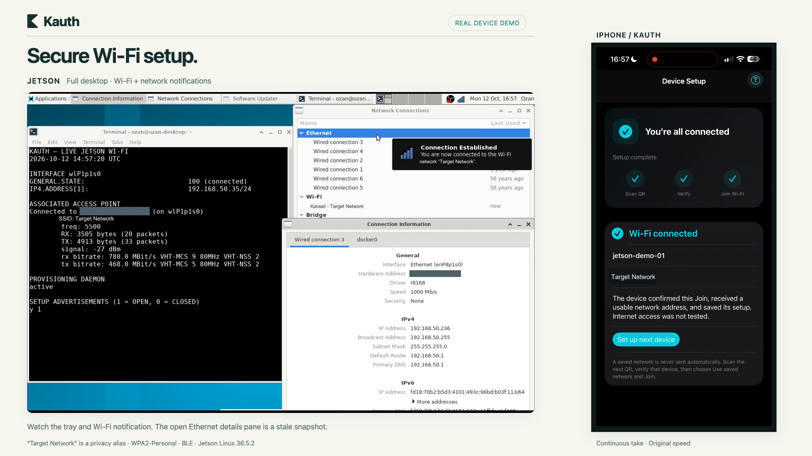

# Kauth

**Scan. Verify. Join.** An independent proof of concept for offline Wi-Fi provisioning of headless Linux devices from an iPhone.

Kauth sends credentials over an authenticated, encrypted Bluetooth Low Energy channel. The Linux device joins the selected Wi-Fi through NetworkManager. The app reports success only after the device confirms the requested network, a usable Wi-Fi IP address, a saved profile and durable setup state.

**[Watch the 44-second real-device demo](evidence/demo.mp4)** · [Architecture](ARCHITECTURE.md) · [Protocol](PROTOCOL.md) · [License: AGPL-3.0](LICENSE)

[](evidence/demo.mp4)

## What it demonstrates

| Design goal | Implementation and evidence |
| --- | --- |
| Offline setup over BLE | CoreBluetooth/BLE GATT carries provisioning; no cloud relay or IP connection between phone and device. Dependencies are installed beforehand. |
| Joins the real target Wi-Fi and verifies it | Recorded iPhone → Jetson join: Wi-Fi becomes connected, receives an address, and the OS and app confirm the result. |
| Credentials encrypted before they leave the phone | HPKE PSK mode protects requests; a session-derived key authenticates/encrypts replies. The QR pins the device key and authorizes setup. |
| Phone flow a field technician can follow from a setup card | Scan the supplied card, select the verified device, choose a network and tap Join. Optional Keychain reuse avoids retyping the site password for each device. |

The [evidence notes](DEMO.md) explain the recording and its limits. “Target Network” is a video privacy alias. The recording does not claim internet reachability or that both endpoints had every other radio disabled.

## Requirements

| Role | Requirements |
| --- | --- |
| Linux device | Ubuntu Desktop 22.04 or 24.04; systemd; active NetworkManager managing Wi-Fi; Python 3.9+; root access; enabled Wi-Fi and a powered Bluetooth controller supporting BLE peripheral advertising/GATT |
| iPhone configurator | iOS 17+; a Mac with an Xcode version supporting the phone's OS; an Apple signing team and Developer Mode |
| Alternative configurator | A second Ubuntu computer or Mac with Bluetooth and Python 3.9+; no iPhone or Xcode needed for the Python CLI |
| Target network | WPA2-Personal AP with usable IP configuration; WPA2/WPA3 transition mode is usable when it advertises WPA2-PSK |

A Jetson is **not required**. The recorded device is a Jetson Orin Nano running Ubuntu 22.04 / Jetson Linux 36.5.2. Ubuntu 24.04 has separate radio-free service/D-Bus smoke evidence, not a recorded physical-radio join. Enterprise/802.1X, WPA3-only, WEP, open networks and non-UTF-8 SSIDs are outside this POC.

## 1. Install the Linux device

Administrative preparation is separate from the technician's setup flow. Copy a trusted `Kauth` folder to the device, for example by cloning the repository or extracting a downloaded archive. Use Ethernet or a local console: Bluetooth restarts can disconnect peripherals and provisioning changes Wi-Fi.

```sh
cd Kauth
sudo ./deploy/install.sh --device-id demodevice1
```

The installed service does not import the `Kauth` folder afterwards. The installer:

- Installs missing prerequisites and a root-owned Python environment under `/opt/karaali-provisioning`.
- Creates a unique private identity under `/var/lib/karaali-provisioning` on first install.
- Exports `qr.json`, `qr.png` and `setup-card.html` into `~/kauth-setup-demodevice1/` for the invoking administrator.
- Enables `karaali-provisioning.service` and sets BlueZ's `ReverseServiceDiscovery=false` for the peripheral-only role.
- Preserves existing networks, Ethernet, DNS, firmware and the Wi-Fi backend. It does not upgrade the OS or take over an unmanaged interface.

If selection is ambiguous, add `--interface wlan0 --adapter hci0`, substituting the actual interface/adapter. NetworkManager must already be active and managing that Wi-Fi interface. Rerunning the installer updates the runtime while preserving the identity, setup state and profiles.

**Keep the setup card private.** It contains a public device key **and a secret granting setup access**. Print it or show it on a trusted screen; never publish an active QR. The device's private key is not exported. Every fresh installation generates its own keys; public test fixtures are never device defaults. For the layout, see [an example card](docs/setup-card-example.pdf) made from the public test identity in `fixtures/interop.json`; it belongs to no real device.

Installation needs package-repository access. The subsequent provisioning exchange needs neither internet nor an initial shared network.

## 2. Build the iPhone app

1. Open `ios/Kauth.xcodeproj` in Xcode and select the **Kauth** scheme.
2. Choose your signing team. The app bundle identifier is `com.ozankaraali.Kauth`; adjust it only if your signing team requires a different unique identifier. This identity is separate from earlier demo installs and their saved-network Keychain items.
3. Connect and trust the iPhone, enable Developer Mode, then run the app. Its displayed name is **Kauth**.
4. Allow Camera and Bluetooth access when requested.

A free Personal Team can be used, subject to Apple's development signing limits. No special Wi-Fi-sharing entitlement is required. The simulator can run crypto/UI tests but cannot demonstrate this Bluetooth/camera flow. The app cannot read passwords saved by iOS.

## 3. Technician workflow

1. **Scan the supplied setup QR.** Nearby-device discovery starts automatically.
2. **Select the device.** Its friendly name is only a hint. Kauth verifies it against the QR before enabling credential entry.
3. **Choose Wi-Fi.** The Linux device supplies the network list. Hidden networks can be entered manually.
4. **Enter the password and tap Join Wi-Fi.** Optionally save the network for the next device. Remembered credentials fill the form; they are never sent automatically.
5. **Wait for the verified connected screen.** It confirms the device's result, not merely that a password was sent.

Keep the app foregrounded during an operation. Successful setup closes BLE advertising; the daemon continues running and NetworkManager retains the Wi-Fi profile. A later Wi-Fi outage does not reopen setup. A timeout or lost final reply means the result is unknown—not permission to show success.

For an explicit offline reproduction, prepare the app/card first, disable phone Wi-Fi and cellular while leaving Bluetooth enabled, and start with the device disconnected from Wi-Fi and other routed links. Use the device's local console/recorder rather than depending on the Ethernet SSH session you disconnect. No fleet-management or cloud connection is involved.

## 4. Reproduce using a second computer

Install the configurator from a copy of the `Kauth` folder on a separate Ubuntu computer or Mac. Transfer **only the QR JSON**, not the device private key, through your trusted preparation channel.

On a second Ubuntu host, install the configurator prerequisites first: `sudo apt-get update && sudo apt-get install -y python3-venv bluez`. On macOS, use a supported Python installation; no Linux network service is needed.

```sh
cd Kauth
python3 -m venv .venv
.venv/bin/python -m pip install -e '.[test]'
.venv/bin/device-provision scan --qr /path/to/private/qr.json
.venv/bin/device-provision configure --qr /path/to/private/qr.json --ssid 'Site-IoT'
```

`configure` prompts privately for the password; there is no password command-line argument. `--hidden` supports a hidden SSID. macOS may request Bluetooth permission for the terminal. This CLI is useful for reproduction and diagnostics; the iPhone is the technician-facing interface.

## 5. Observe and maintain

On Linux, substitute the actual Wi-Fi interface for `wlan0`:

```sh
nmcli device status
nmcli -f GENERAL.STATE,GENERAL.CONNECTION,IP4.ADDRESS,IP6.ADDRESS device show wlan0
sudo journalctl -u karaali-provisioning.service -n 40 --no-pager
```

Check the **Wi-Fi interface**, not an Ethernet IP. Do not use `nmcli --show-secrets` or print identity files when collecting evidence.

```sh
# Reopen setup for five minutes; preserve keys and existing Wi-Fi.
sudo /opt/karaali-provisioning/.venv/bin/device-provision reopen \
  --identity /var/lib/karaali-provisioning/identity.json

# IT reset: remove only the validated tracked profile, rotate keys and issue a new card.
# Use Ethernet/local console and a NEW output directory.
sudo /opt/karaali-provisioning/bin/reset.sh --output-dir "$HOME/kauth-reset-01"

# Uninstall runtime/service, retaining identity/state/Wi-Fi for reinstall.
sudo /opt/karaali-provisioning/bin/uninstall.sh
```

These are separate administrative actions, not a sequence to run after every join. See [operations and recovery](docs/OPERATIONS.md) for purge, ownership checks, interrupted operations and Jetson prerequisites. Reset revokes Kauth's application trust; it does not clear unrelated OS Bluetooth bonds.

## 6. Tests

```sh
cd Kauth
python3 -m venv .venv
.venv/bin/python -m pip install -e '.[test]'
.venv/bin/python -m pytest -q
```

The Python suite covers cryptographic vectors, wrong keys/secrets, tampering and replay, bounded framing, provisioning state, NetworkManager failure/rollback models and maintenance ownership/key rotation. In Xcode, **Product → Test** on the **Kauth** scheme runs the `KauthTests` Swift suite on a supported device or simulator. Use normal signing; unsigned test hosts cannot access the iOS Keychain.

Tests with modeled D-Bus/radio boundaries are not physical hardware qualification. The [evidence ledger](DEMO.md) distinguishes fresh Python and Swift checks from real-device observations; [checks.json](evidence/checks.json) records the exact results and source hashes.

## Repository map

- `ios/` — SwiftUI app, CoreBluetooth transport, CryptoKit protocol, Keychain and tests.
- `python/device_provision/` — Linux device service and Python configurator.
- `deploy/` — Ubuntu installer, systemd unit, scoped reset/uninstall and BlueZ policy ownership.
- `tests/`, `fixtures/` — deterministic tests and public known-answer vectors.
- `ARCHITECTURE.md`, `PROTOCOL.md` — brief design and exact wire/security appendix.
- `docs/OPERATIONS.md`, `docs/setup-card-example.pdf` — operations, recovery and maintenance details, and an example setup card made from the public test identity.
- `make_setup_card.py` — renders an existing device QR as a private printable setup card.
- `evidence/` — redacted recording, poster and machine-readable check results.
- `k-icon-final.svg`, `k-glyph-final.svg` — Kauth artwork.
- [`THIRD_PARTY_NOTICES.md`](THIRD_PARTY_NOTICES.md) — dependency licenses, the redistributed IETF HPKE test vector and artwork provenance.

Runtime identifiers retain the `device-provision` CLI, the `device_provision` Python package and the `karaali-provisioning` service and paths; the product, iOS project and archive are Kauth. Package 3.0.0 and both configurators use wire v3 and QR schema 1.

## License

Copyright (C) 2026 Ozan Karaali

Kauth is free software: you can redistribute it and/or modify it under the terms of the GNU Affero General Public License as published by the Free Software Foundation, either version 3 of the License, or (at your option) any later version. It is distributed in the hope that it will be useful, but WITHOUT ANY WARRANTY; without even the implied warranty of MERCHANTABILITY or FITNESS FOR A PARTICULAR PURPOSE. See [LICENSE](LICENSE) for the full text.

If you distribute a modified version, or run one for users over a network, the AGPL requires you to make your modified source available under the same license. Third-party material keeps its own terms; see [THIRD_PARTY_NOTICES.md](THIRD_PARTY_NOTICES.md).
